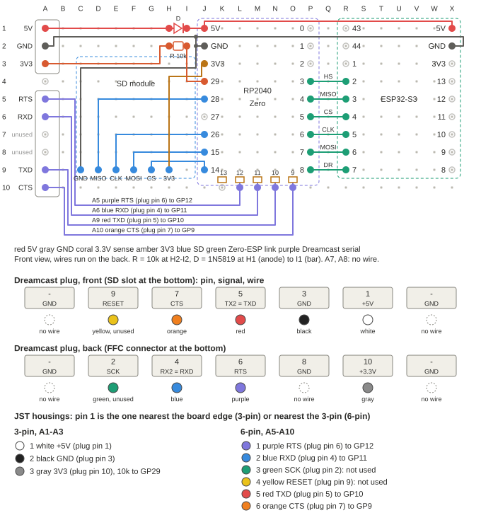

# Perfboard build (RP2040-Zero + ESP32-S3 SuperMini + SD module)

One board, no copper strips: a 3 x 7 cm single-hole perfboard with the columns A-X and the rows 1-10
printed on it. Same pin map as the soldered stack ([ESP32.md](ESP32.md)) and the stripboard
([STRIPBOARD.md](STRIPBOARD.md)), so the same firmware runs: the cable image built with
`-DDC_BOARD=zero-stack` and the ESP32 image built with `sdkconfig.zero-stack`.

Drawing: [perfboard.svg](perfboard.svg). It is the front view; every wire runs on the back, where the
letters run the other way if you turn the board over end for end. Count from the front.
Insulated wire, crossings are fine.

## Where everything sits (front view, plug end at the left)

| Part | Holes |
|---|---|
| 3-pin JST (power) | A1-A3 |
| 6-pin JST (serial) | A5-A10 (A4 is the empty hole between them) |
| SD module pins (GND, MISO, CLK, MOSI, CS, 3V3) | C9-H9, module body over C-I |
| RP2040-Zero, USB up | left pins J1-J9 (5V, GND, 3V3, 29, 28, 27, 26, 15, 14), right pins P1-P9 (0..8) |
| Zero bottom-edge pads GP13..GP9 | over K-O, wired to the holes K10-O10 right under them |
| ESP32-S3 SuperMini, USB up | left pads R1-R9 (43, 44, 1, 2, 3, 4, 5, 6, 7), right pads X1-X9 (5V, GND, 3V3, 13, 12, 11, 10, 9, 8) |
| 1N5819 | H1 (anode) and I1 (cathode, bar towards the Zero), standing |
| 10 kΩ | H2 and I2, standing |

Check the ESP32 columns against its printed pin names before soldering; the drawing assumes R and X.

## Wires

Power (from the 3-pin JST):

| From | To | What |
|---|---|---|
| A1 | H1 | 5V into the diode |
| I1 | J1 | Zero 5V |
| J1 | X1 | ESP32 5V |
| A2 | J2 | GND, then J2 to X2 (ESP32 GND) and C9 (SD GND) to J2 |
| A3 | H2 | the Dreamcast's 3.3V, only for the sense input |
| I2 | J4 | other end of the 10 kΩ to GP29 |

The 3.3V from the plug never goes to a 3V3 pin. No fuse yet: the A1-H1 wire is where one goes
(cut it and splice in a resettable fuse, about 0.5 A hold). Plug in only one USB at a time.

SD module (the module's own labels): MISO D9 to J5 (GP28), CLK E9 to J7 (GP26), MOSI F9 to J8 (GP15),
CS G9 to J9 (GP14), 3V3 H9 to J3 (the Zero's 3V3).

Zero to ESP32 link, six straight wires across column Q, each in its own row:
P4-R4 HS (GP3, GPIO2), P5-R5 MISO (GP4, GPIO3), P6-R6 CS (GP5, GPIO4), P7-R7 CLK (GP6, GPIO5),
P8-R8 MOSI (GP7, GPIO6), P9-R9 DR (GP8, GPIO7).

Dreamcast serial (from the 6-pin JST): A5 to L10 (GP12, RTS), A6 to M10 (GP11, RXD),
A9 to N10 (GP10, TXD), A10 to O10 (GP9, CTS). A7 and A8 have no wire.
The optional 1 kΩ from the GP13 pad (K10) to the GP9 pad (O10) is not on the drawing: serial works without it.

## The Dreamcast plug (DC SD Adapter V1.3 board)

Pin numbers are the Dreamcast's serial port pins; the board's own labels are in the second column.

| Wire | Plug pad | Pin | Goes to |
|---|---|---|---|
| white | +5V (front) | 1 | 3-pin pin 2 |
| black | GND (front) | 3 | 3-pin pin 1 |
| gray | +3.3V (back) | 10 | 3-pin pin 3 |
| blue | RX2 (back) | 4 | 6-pin pin 2, the Dreamcast's RXD |
| red | TX2 (front) | 5 | 6-pin pin 5, the Dreamcast's TXD |
| purple | RTS (back) | 6 | 6-pin pin 1 |
| orange | CTS (front) | 7 | 6-pin pin 6 |
| yellow | RESET (front) | 9 | 6-pin pin 4, not used |
| green | SCK (back) | 2 | 6-pin pin 3, not used |

Pin 1 of the 3-pin is the one nearest the board edge, pin 1 of the 6-pin the one nearest the 3-pin.
The crimps go into the housings in this order, not in ribbon order: red and orange are swapped
against the ribbon so the four serial wires never cross on the back. Leave the yellow and green wires
unconnected on the board and keep them insulated.

## Before the first power-up

1. Continuity: no beep between 5V and GND (A2 against A1, J1 against J2, X1 against X2), none between 3V3 and GND.
2. A3 to J4 reads 10 kΩ, A3 to a 3V3 pin is open.
3. Each of the six link wires beeps end to end, and none beeps to its neighbour.
4. Flash the cable UF2 over BOOTSEL and the ESP32 first image with esptool, one USB cable at a time.
5. The first status line in `journalctl` carries `git describe`: check it before reporting a problem.

Untested on hardware at the time of writing.
