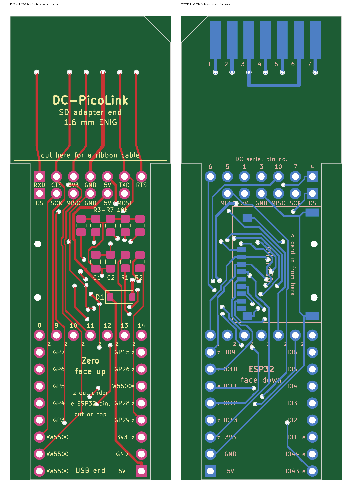

# Stack PCB: RP2040-Zero + ESP32-S3 SuperMini with an SD-card plug

> ⚠️ Not made or tested yet. Routed and checked with KiCad's DRC (0 errors, 0 unconnected). Check the
> points under **Before ordering** against your own parts first.

The middle board of a 3-board stack ([../ESP32.md](../ESP32.md#the-rp2040-zero--esp32-s3-supermini-stack-spi-link)):
the RP2040-Zero on its top face, the ESP32-S3 SuperMini on its bottom face, joined by long pins.
Its far end is shaped like a full-size SD card and goes into the slot of the DC SD adapter, so the
stack plugs straight into the Dreamcast's serial port. 18 mm wide (the modules' width), 24 mm at the
card end (an SD card's width: the slot needs it), 69.5 mm long.

On the board:

* **SD card end**: the Dreamcast lines on the card's contacts, wired as the DC SD adapter does
  (SPI over the serial port: TXD = MOSI, RXD = MISO, RTS = CS, CTS = SCK; [../WIRING.md](../WIRING.md)):
  contact 1 (CS) GP12 = DC RTS, 2 (CMD) GP10 = DC TXD, 3 and 6 GND, 4 the Dreamcast's 3.3 V,
  5 (CLK) GP9 = DC CTS, 7 (DAT0) GP11 = DC RXD.
* **Ribbon-cable row** (7 holes, 2.54 mm) right behind it, with the same signals: RXD, CTS, 3V3, GND,
  5V, TXD, RTS (power together, ground between the two supplies; the Dreamcast serial pin numbers
  4, 7, 10, 3, 1, 5, 6 are printed on the back).
  The card end is wired straight into these holes, so it can be **cut off along the printed line**
  and the stack wired to a serial plug with a ribbon cable instead.
* **5 V in**: ribbon hole 5, through D1 into the stack's 5V. The SD slot has no 5 V (its
  3.3 V is the Dreamcast's, sized for an SD card, and is only used for sensing here): power the stack
  through this hole (the Dreamcast's serial pin 1, or a charger) or a USB port. See [../ESP32.md#power](../ESP32.md#power).
* **W5500 row** (6 holes, under the ribbon row): CS, SCK, MISO, GND, 5V, MOSI for a W5500 Ethernet
  module on six jumper wires. The common blue module (2×5 header) has its own 3.3 V regulator and is
  fed from 5V; its 3V3, RST and INT pins stay free. The four signals come from ESP32 pins that reach
  this board where the Zero has nothing: IO43 (CS), IO44 (MISO), IO1 (SCK), IO11 (MOSI). The ESP32
  firmware for this board: add `sdkconfig.stack-pcb` (with the modem build also
  `sdkconfig.stack-pcb-modem`, which turns the serial console off: the W5500 has its pins; the log is
  on the web page as always).
* R1 1 kΩ GP13 → GP9 (flow control), R2 10 kΩ GP29 → the Dreamcast's 3.3 V (power sense).
* **microSD socket** for the slot card ([../SD-SLOT.md](../SD-SLOT.md): GP26 SCK, GP15 MOSI, GP28 MISO,
  GP14 CS) between the card end and the stack, on the ESP32's face, the card going in from the left
  edge (away from both USB ports). With 10 µF + 100 nF and 10 kΩ pull-ups on CS, MOSI, MISO, DAT1 and DAT2.

Same pin map and firmware as the soldered stack: cable `-DDC_BOARD=zero-stack`, ESP32 `sdkconfig.zero-stack`.

## Parts

| Ref | Part | Package | Face |
|---|---|---|---|
| J4 | **TF-01A** push-push microSD socket (Korean Hroparts, LCSC C91145, ~0.1-0.2 USD) | SMD | bottom |
| R3-R7 | 10 kΩ (card pull-ups) | 0805 | top |
| C1, C2 | 10 µF, 100 nF (card supply) | 0805 | top |
| R1 | 1 kΩ | 0805 | top |
| R2 | 10 kΩ | 0805 | top |
| D1 | B5819W (or SS14 in SOD-123F / any 1 A Schottky in SOD-123) | SOD-123 | top |
| – | long 2.54 mm pin headers (≥ 15 mm), 2 × 9 + 5 | | |
| – | optional: 7-pin 2.54 mm header for the ribbon cable, 6-pin for the W5500 | | |

Everything solders with an iron: the 0805 and SOD-123 parts use the hand-soldering pads, and the
socket's pins are 1.1 mm apart. Through-hole resistors and a DO-41 diode would not fit in the 18 mm
body without making the board longer.

The socket's land pattern is the one Bus Pirate 5 uses for the same part (checked against two other
open designs: they agree within 0.1 mm). Pins 1-8 are the microSD contacts in the usual order, pin 9
the card switch (not used).

## The stack pins

The Zero has 8 holes down each side and 7 along its bottom edge (GP8, GP9 … GP13, GP14): the corner
holes GP8 and GP14 are both the last side hole and the ends of the bottom row. The board has a hole
under each. The mark beside each hole (both faces) says how it is fitted:

* no mark: **one long pin through all three boards** (5V, GND; the six link pins GP3-GP8 ↔ ESP32 GPIO2-7);
* **z**: a pin from the Zero into this board only, **cut flush underneath** before the ESP32 goes on:
  3V3, GP29, GP28, GP26, GP15, GP14 and the bottom row GP9-GP13 (these must never reach the ESP32,
  see the table in ESP32.md);
* **e**: a pin from the ESP32 into this board only, **cut flush on top**; the Zero gets no pin there
  (its GP0, GP1, GP2 and GP27 are unused): IO43, IO44, IO1, IO11 for the W5500.

Every hole carries a signal, so none could be left out.

## Before ordering

* **SD contact positions**: they come from KiCad's SD socket footprints (two makers agree), not
  from a measured card. Print the board 1:1 and lay an SD card on it: the seven gold contacts
  must sit on the seven pads.
* **Your adapter's wiring**: the pin mapping is the standard one for these adapters (the jj1odm
  design that KallistiOS and DreamShell expect), and your own serial plug's labels match it. To be
  certain, check with a multimeter between the adapter's serial plug and its slot: CTS → card
  contact 5, TXD → 2, RXD → 7, RTS → 1, 3.3 V → 4, GND → 3 and 6.
* **Which way up**: the contacts are on the ESP32's face (the blue side in the pictures), which faces
  up in the adapter: the ESP32 is on top and the Zero underneath. The Zero then hangs about
  7 mm below the card (2.5 mm spacer + board + its USB-C socket): check the gap to the table.
  The power plug sits right above the adapter, and the stack starts where the card leaves the slot.
* **Card end length**: 22 mm, for an adapter that takes ~20 mm of the card (about 12 mm of a card
  sticking out, as in the photo). If more of your card goes in, raise `CARD` in `gen_board.py`.
* **Board**: 1.6 mm, **ENIG** (gold) finish: the contacts rub on the slot's springs. An SD card is
  2.1 mm thick. If the board is loose in the slot, a strip of Kapton on the top face of the card
  end takes up the play.
* The hole positions assume the Zero's and the SuperMini's first pin about 1.3 mm from the USB end,
  as in ESP32.md. Check with calipers.

## Assembly

1. SMD parts: the microSD socket on the bottom, the resistors, capacitors and D1 on top (D1's band
   toward the stack).
2. The four **e** holes first: a pin from below in each (header plastic underneath, like the ESP32's
   other pins), soldered on top and cut flush there.
3. Zero on top, face up, USB at the square end. Long pins through all its holes except the **e** ones;
   solder the top joints.
4. Cut the **z** pins flush underneath (the bottom row too). Kapton on the ESP32's back is a good idea
   (the board's tracks run under it). ESP32 face down onto the long pins and the **e** pins, USB at the
   same end; solder.
5. Before power: with a meter, check that the Zero's 3V3 and the ESP32's 3V3 are **not** joined,
   and that SD contact 4 does not touch either 3V3.

## Files

* `gen_board.py`: the whole board as a script (outline, parts, nets, labels): edit here.
* `make.sh`: generate → autoroute (Freerouting 1.9) → DRC → Gerbers, drill, pictures. Needs KiCad 7,
  Java and Xvfb: `FREEROUTING=/path/freerouting-1.9.0.jar ./make.sh build`. The router's result
  differs a little from run to run; the script stops if anything gets routed on the card end.
* `ses_import.py`: puts Freerouting's routes onto the board (pcbnew's own import needs the GUI).
* `dc-picolink-stack.kicad_pcb` / `.kicad_pro`: the routed board (KiCad 7+). No schematic: the nets
  are in `gen_board.py`.
